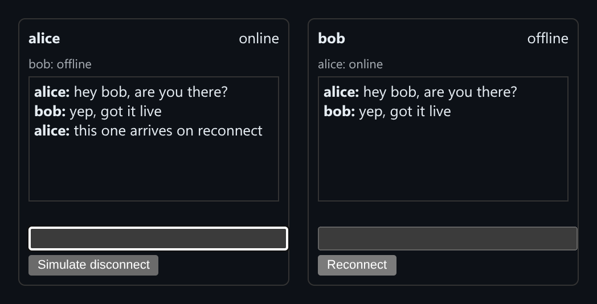

# WebSocket Chat Room

Chat room with presence, typing indicators and reconnect-with-replay, built against an in-memory mock server.



*Alice and Bob chat live. Bob then disconnects and Alice sends another message. Bob gets that message from the replay log when he reconnects.*

## Features

- **Presence**: each panel shows whether the other user is online or offline.
- **Typing indicators** are sent as their own message type.
- **Monotonic sequence numbers**: the server stamps every broadcast with a `seq` and keeps it in a log.
- **Reconnect replay**: a reconnecting client sends back the last `seq` it saw, and the server replays everything after it, so messages sent while it was offline are not lost.
- **Simulate disconnect / Reconnect** button on each panel.

## How it works

The demo uses a `ChatServer` class instead of a real socket so the protocol is easy to see. Each client sends its last-seen sequence number when it connects. The server answers with the missed messages from its log, then switches to the live stream.

## Usage

```tsx
import { ChatServer, ChatPanel } from './ChatRoom';

const server = new ChatServer();

<ChatPanel server={server} userId="alice" />
<ChatPanel server={server} userId="bob" />
```

## API

- `new ChatServer()`: in-memory server. Methods: `connect(userId, deliver, lastSeenSeq)`, `disconnect(userId)`, `sendChat(userId, text)`.
- `<ChatPanel server userId />`: one user's chat window.
- `ServerMessage`: `{ seq, type: 'chat' | 'presence' | 'typing', payload, timestamp }`.
- Default export `Demo`: two panels sharing one server.

## Files

| File | Purpose |
| --- | --- |
| [`ChatRoom.tsx`](ChatRoom.tsx) | Component, hooks and demo (default export) |
| [`preview.png`](preview.png) | Screenshot of the running demo |

Only depends on `react`.
