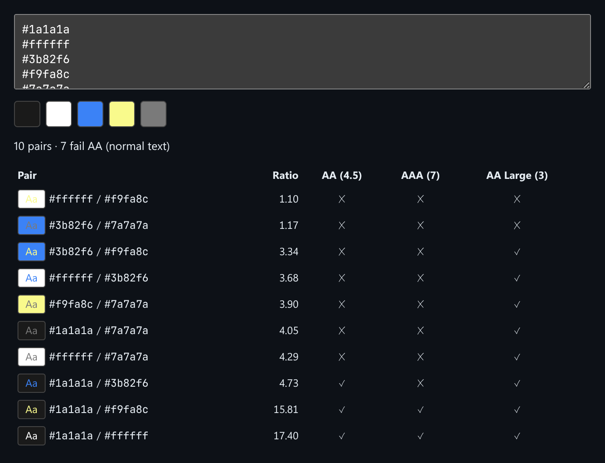

# Color Contrast Auditor

Paste a palette and get the WCAG contrast ratio for every pair of colors, with AA / AAA pass or fail.



*A 5-color palette produces 10 pairs, sorted by ratio. 7 of them fail AA for normal text.*

## Features

- Accepts hex colors **one per line, or separated by commas or spaces**.
- Shows a **swatch strip** of the parsed palette.
- Checks **every pair** and shows a live "Aa" sample of each pair.
- Columns for **AA (4.5)**, **AAA (7)** and **AA Large (3)**.
- A summary line: total pairs and how many fail AA.

## How it works

All the math runs in the browser and follows the WCAG 2.x formula: relative luminance with sRGB gamma correction, then `(L1 + 0.05) / (L2 + 0.05)`.

## Usage

```tsx
import { ContrastAuditor, contrastRatio } from './ContrastAuditor';

<ContrastAuditor initialPalette={['#1a1a1a', '#ffffff', '#3b82f6']} />

contrastRatio('#1a1a1a', '#ffffff'); // 17.40
```

## API

- `<ContrastAuditor initialPalette?: string[] />`
- `contrastRatio(hexA, hexB): number`: WCAG contrast ratio of two hex colors.
- Default export `Demo`: starts with a sample palette.

## Files

| File | Purpose |
| --- | --- |
| [`ContrastAuditor.tsx`](ContrastAuditor.tsx) | Component, hooks and demo (default export) |
| [`preview.png`](preview.png) | Screenshot of the running demo |

Only depends on `react`.
