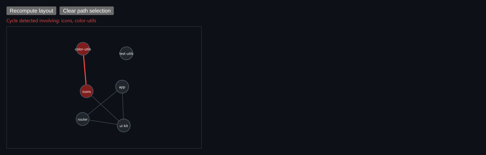

# Dependency Graph Explorer

A force-directed package graph with cycle detection and shortest-path highlighting.



*The sample graph has a deliberate cycle (`icons -> color-utils -> icons`), which is flagged in red.*

## Features

- **Force-directed layout**: every pair of nodes repels, edges pull like springs, and a weak force pulls toward the center.
- **Deterministic**: the layout runs for a fixed number of steps, so **Recompute layout** gives the same result every time.
- **Cycle detection** on the *directed* graph with a recursion-stack DFS. Nodes and edges in a cycle turn red, with a banner listing them.
- **Path highlighting**: click two nodes to see the shortest path between them (BFS on the *undirected* graph).
- **Clear path selection** button.

## How it works

The layout simulation, cycle finder and path finder are plain exported functions, so you can use them without the component. Path search ignores edge direction, because "how are these two packages related?" usually doesn't depend on which one imports which.

## Usage

```tsx
import { DependencyGraph } from './DependencyGraph';

const nodes = [{ id: 'app', label: 'app' }, { id: 'ui-kit', label: 'ui-kit' }];
const edges = [{ from: 'app', to: 'ui-kit' }];

<DependencyGraph nodes={nodes} edges={edges} />
```

## API

- `<DependencyGraph nodes: GraphNode[] edges: GraphEdge[] />`
- `simulateLayout(nodes, edges, iterations = 300)`: returns the nodes with `x` and `y` positions.
- `findCycles(nodes, edges)`: returns `{ edgeKeys, nodeIds }` for everything in a cycle.
- `shortestPath(nodes, edges, startId, endId)`: returns `string[] | null`.

## Files

| File | Purpose |
| --- | --- |
| [`DependencyGraph.tsx`](DependencyGraph.tsx) | Component, hooks and demo (default export) |
| [`preview.png`](preview.png) | Screenshot of the running demo |

Only depends on `react`.
