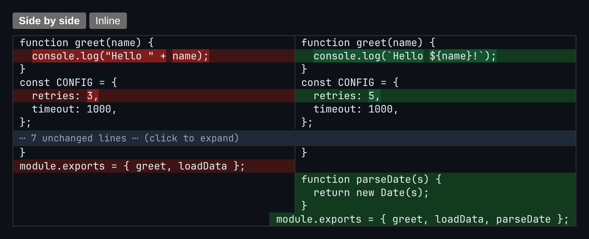

# Diff Viewer

Side-by-side and inline text diffs with word-level highlights. No diff library is used.



*Side-by-side mode. Changed lines get word-level highlights, and a run of 7 unchanged lines is collapsed.*

## Features

- **Side by side** and **Inline** view modes.
- **Line diff** using LCS (longest common subsequence).
- **Word-level highlighting**: the same LCS runs again over the tokens of each matched remove/add pair.
- A pair is only treated as a modification when both sides have the **same number of lines**. Otherwise it shows as a separate removal and addition.
- **Collapsible unchanged runs**: long stretches show as "N unchanged lines (click to expand)", keeping 2 lines of context around each change.

## How it works

Line operations of the same type are grouped together. A removal run next to an addition run of the same length is merged into a "modify" block, so the two sides can be paired line by line and diffed word by word.

## Usage

```tsx
import { DiffViewer } from './DiffViewer';

<DiffViewer before={oldText} after={newText} />
```

## API

- `<DiffViewer before: string after: string />`
- Default export `Demo`: a sample before/after code snippet.

## Files

| File | Purpose |
| --- | --- |
| [`DiffViewer.tsx`](DiffViewer.tsx) | Component, hooks and demo (default export) |
| [`preview.png`](preview.png) | Screenshot of the running demo |

Only depends on `react`.
