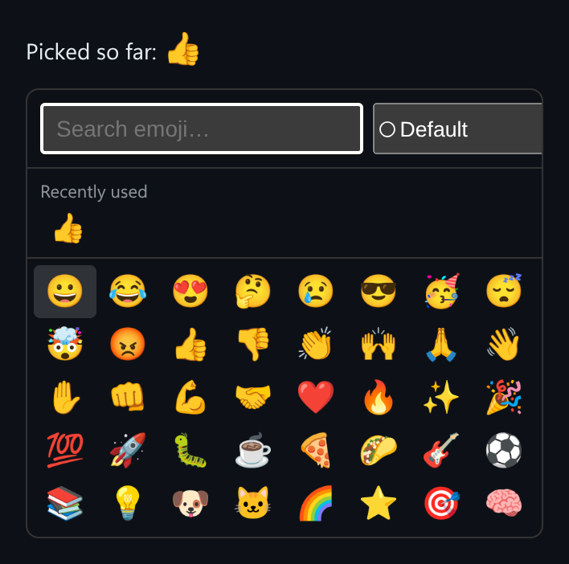

# Emoji Picker

Fuzzy-search emoji picker with skin tones, a recently-used row, and full keyboard control.



*After searching "thmb" and pressing Enter, 👍 is picked and appears in **Recently used**.*

## Features

- **Fuzzy search** over names and keywords. Typed characters must appear in order, and contiguous runs and early matches score higher, so "thmb" finds "thumbs up".
- A **skin-tone selector** for emoji that support it.
- A **Recently used** row saved to `localStorage`. If storage is unavailable, it just isn't saved.
- **Keyboard control**: type to search, arrow keys to move through the grid, Enter to pick, Escape to clear.

## How it works

The search is a scored subsequence match, not a substring match. Recent picks are stored in `localStorage`, and if storage throws (for example in private mode), the picker keeps working without saving them.

## Usage

```tsx
import { EmojiPicker } from './EmojiPicker';

<EmojiPicker onSelect={(emoji) => insertAtCursor(emoji)} />
```

## API

- `<EmojiPicker onSelect: (emoji: string) => void />`
- Default export `Demo`: the picker plus a "Picked so far" readout.

## Files

| File | Purpose |
| --- | --- |
| [`EmojiPicker.tsx`](EmojiPicker.tsx) | Component, hooks and demo (default export) |
| [`preview.png`](preview.png) | Screenshot of the running demo |

Only depends on `react`.
