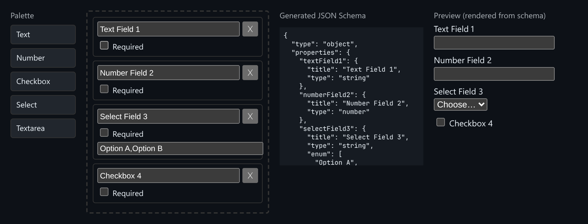

# Form Schema Builder

Drag fields onto a canvas and watch a JSON Schema and a live form preview update together.



*Text, Number, Select and Checkbox fields were dragged in. The schema and the preview update live.*

## Features

- A **palette** of field types: Text, Number, Checkbox, Select, Textarea.
- **Drag and drop** fields onto the canvas using pointer events.
- **Per-field settings**: label, required flag, and comma-separated options for selects.
- **Live JSON Schema output**: `type: object`, `properties`, `required`.
- The **preview is rendered from the schema**, not from the internal field list, so the schema is guaranteed to fully describe the form.
- **Property keys** are camelCased from each label, with duplicates renamed.

## How it works

The builder keeps a list of fields, turns it into a JSON Schema, and builds the preview from that schema alone. If the schema were missing anything, the preview would be missing it too.

## Usage

```tsx
import FormSchemaBuilder from './FormSchemaBuilder';

<FormSchemaBuilder />
```

## API

- Default export `FormSchemaBuilder`: takes no props.

## Files

| File | Purpose |
| --- | --- |
| [`FormSchemaBuilder.tsx`](FormSchemaBuilder.tsx) | Component, hooks and demo (default export) |
| [`preview.png`](preview.png) | Screenshot of the running demo |

Only depends on `react`.
