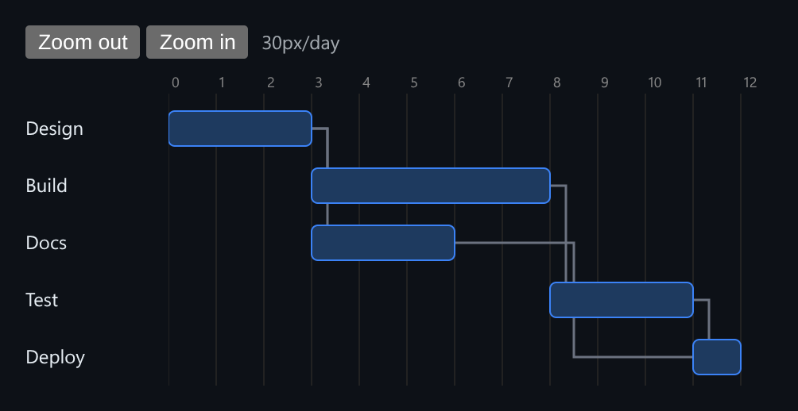

# Gantt Timeline

A zoomable Gantt chart with dependency arrows, where dragging a task reschedules everything that depends on it.



*Five tasks with elbow-style dependency arrows, at 30px per day.*

## Features

- **Zoomable day axis**: Zoom in / Zoom out changes pixels per day, and every bar and arrow scales with it.
- **Dependency arrows** drawn as elbow connectors from the end of a prerequisite to the start of the task that depends on it.
- **Drag to reschedule with a cascade**: if a moved task would make a dependent start before it ends, that dependent moves forward by exactly enough, all the way down the chain.
- **Integer day offsets** instead of `Date` objects, so the math is exact and there are no timezone issues.

## How it works

`rescheduleTask` moves one task, then recursively pushes forward any dependent that now starts too early. Moving the first task in the chain therefore moves everything after it, like a real project plan.

## Usage

```tsx
import { GanttChart, type Task } from './GanttChart';

const tasks: Task[] = [
  { id: 'design', label: 'Design', start: 0, end: 3, dependsOn: [] },
  { id: 'build', label: 'Build', start: 3, end: 8, dependsOn: ['design'] },
];

<GanttChart initialTasks={tasks} />
```

## API

- `<GanttChart initialTasks: Task[] />`
- `Task`: `{ id, label, start, end, dependsOn: string[] }`. `start` and `end` are day offsets, and `end` is exclusive.
- `rescheduleTask(tasks, taskId, newStart): Task[]`: a pure function that applies the cascade.

## Files

| File | Purpose |
| --- | --- |
| [`GanttChart.tsx`](GanttChart.tsx) | Component, hooks and demo (default export) |
| [`preview.png`](preview.png) | Screenshot of the running demo |

Only depends on `react`.
