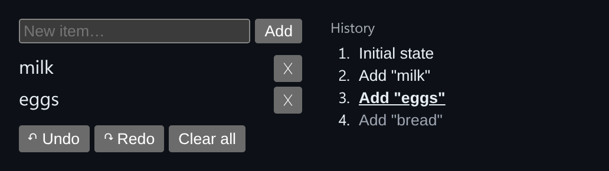

# Undo / Redo History Store

A command-pattern store with labeled snapshots, undo/redo, and click-to-jump history.



*After adding milk, eggs and bread, then pressing Undo, the pointer sits on `Add "eggs"` and `Add "bread"` is greyed out as a redo step.*

## Features

- Every `dispatch` adds a **labeled snapshot** instead of changing state in place.
- **Undo / Redo** move a pointer through the history.
- A **history panel** shows that pointer. Click any entry to jump straight to it.
- **Future-branch truncation**: dispatching while you are behind the latest entry discards the old redo steps, like a real editor's undo stack.

## How it works

The hook keeps an array of `{ label, state }` entries and a pointer into it. The current state is `entries[pointer].state`, so undo and redo just move the pointer.

## Usage

```tsx
import { useHistoryStore } from './HistoryStore';

const store = useHistoryStore<string[]>([]);
store.dispatch('Add "milk"', (list) => [...list, 'milk']);
store.undo();
store.redo();
store.jumpTo(0);
```

## API

- `useHistoryStore<T>(initial)` returns `{ state, entries, pointer, dispatch, undo, redo, jumpTo, canUndo, canRedo }`.
- `dispatch(label, updater)`: `updater` is either a new state or a function `(state) => newState`.
- Default export `Demo`: a shopping list.

## Files

| File | Purpose |
| --- | --- |
| [`HistoryStore.tsx`](HistoryStore.tsx) | Component, hooks and demo (default export) |
| [`preview.png`](preview.png) | Screenshot of the running demo |

Only depends on `react`.
