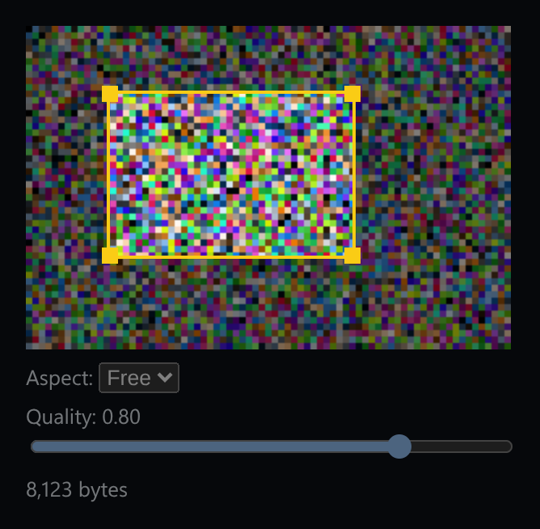

# Image Crop & Compress

A crop box with four corner handles, aspect-ratio lock, and a real JPEG byte-size readout.



*The crop box over the generated source image, with the aspect selector, quality slider and real encoded size.*

## Features

- **Four corner handles**. Each drag is calculated from the **opposite corner**, which stays fixed, so resizing works correctly from any corner.
- **Aspect lock**: Free, 1:1, 16:9 or 4:3. Height is derived from the dragged width, and if the canvas edge limits the height, the width shrinks to keep the ratio.
- The box is **kept inside the canvas** at all times.
- **Real byte size**: every change redraws the crop onto an off-screen canvas and calls `toBlob(..., 'image/jpeg', quality)`.
- A **quality slider** that changes the encoded file size for real.

## How it works

The source image is generated from a fixed pseudo-noise pattern (not `Math.random`), so the tool works offline and the byte sizes are the same every run. If a newer encode request starts, older results are ignored.

## Usage

```tsx
import ImageCropTool from './ImageCropTool';

<ImageCropTool />
```

## API

- Default export `ImageCropTool`: takes no props.

## Files

| File | Purpose |
| --- | --- |
| [`ImageCropTool.tsx`](ImageCropTool.tsx) | Component, hooks and demo (default export) |
| [`preview.png`](preview.png) | Screenshot of the running demo |

Only depends on `react`.
