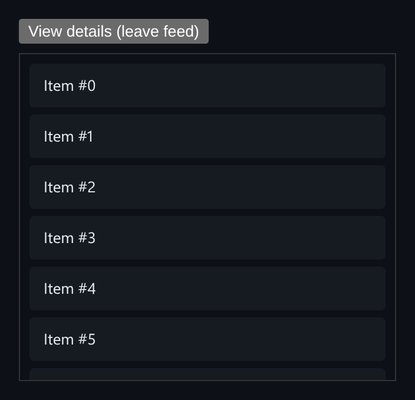

# Infinite Scroll Feed

Infinite scrolling with IntersectionObserver that restores both scroll position and loaded pages when you come back.



*The feed after the first page has loaded inside its scroll container.*

## Features

- An **IntersectionObserver** watches a sentinel after the last item. When it scrolls into view, the next page loads.
- **Skeleton placeholders** show while a page is loading.
- **Scroll restoration**: leaving the feed with "View details" and coming back restores the scroll position *and* the loaded items.
- The scroll position is restored **before paint**, so there is no visible jump.
- The observer is **set up once**. It reads loading, done and page state through refs instead of being recreated on every load.

## How it works

When the feed unmounts, it caches its items, page, done flag and `scrollTop`. It reads these through refs, because the cleanup closure was created at mount and would otherwise see stale state. `scrollTop` is tracked in its own ref because React has already cleared DOM refs by the time cleanup runs.

## Usage

```tsx
import { InfiniteFeed } from './InfiniteFeed';

<InfiniteFeed />
```

## API

- `<InfiniteFeed />`: loads 10 items per page.
- Default export `Demo`: adds a "View details" toggle that stands in for a route change.

## Files

| File | Purpose |
| --- | --- |
| [`InfiniteFeed.tsx`](InfiniteFeed.tsx) | Component, hooks and demo (default export) |
| [`preview.png`](preview.png) | Screenshot of the running demo |

Only depends on `react`.
