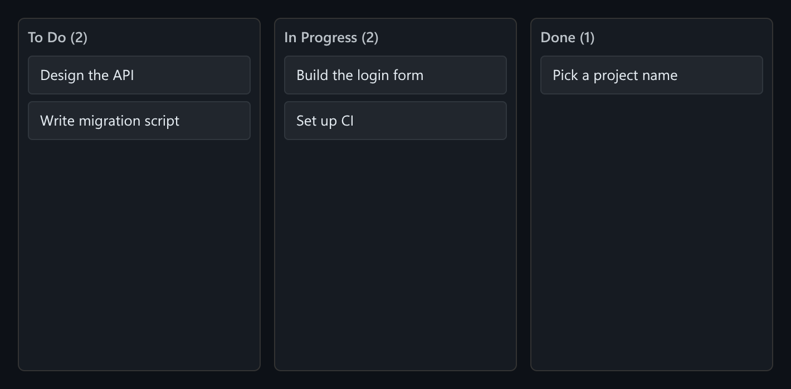

# Kanban Board

Drag-and-drop Kanban built on pointer events, with the board saved to localStorage.



*The starting board: To Do, In Progress and Done columns with card counts.*

## Features

- **Pointer-events drag**, not the native HTML5 drag-and-drop API.
- A **placeholder line** shows where the card will land.
- **Drop targets** between cards and at the end of each column.
- Cards can **move between columns**.
- **Saved to localStorage** (`kanban-board-cards`) on every change and loaded on mount, so the board survives a reload.

## How it works

A floating copy of the card follows the pointer while a drop target (`columnId` plus the card to insert before, or `null` for the end of the column) is recalculated. If storage is unavailable, the board still works but isn't saved.

## Usage

```tsx
import KanbanBoard from './KanbanBoard';

<KanbanBoard />
```

## API

- Default export `KanbanBoard`: takes no props and starts with seed data.

## Files

| File | Purpose |
| --- | --- |
| [`KanbanBoard.tsx`](KanbanBoard.tsx) | Component, hooks and demo (default export) |
| [`preview.png`](preview.png) | Screenshot of the running demo |

Only depends on `react`.
