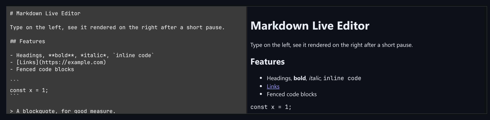

# Markdown Live Editor

A split-pane Markdown editor with a debounced preview and scroll sync between the panes.



*Markdown source on the left and the rendered preview on the right.*

## Features

- **Split pane**: source on the left, rendered HTML on the right.
- **Debounced preview**: re-renders `debounceMs` after typing stops, not on every keystroke.
- **Scroll sync by percentage**: scrolling one pane moves the other to the same relative position, with a flag to stop feedback loops.
- A small built-in parser: headings, bold and italic, inline code, links, fenced code blocks, blockquotes, and `- ` / `* ` lists.

## How it works

The parser re-reads the whole document, so debouncing keeps large documents from being parsed many times a second while typing. The panes are rarely the same height, so scroll sync matches percentages instead of pixels.

## Usage

```tsx
import { MarkdownEditor, markdownToHtml } from './MarkdownEditor';

<MarkdownEditor initialValue={'# Hello\n\nSome *text*.'} debounceMs={250} />

markdownToHtml('**bold**');
```

## API

- `<MarkdownEditor initialValue?: string debounceMs?: number />` (`debounceMs` defaults to 250).
- `markdownToHtml(src): string`

## Files

| File | Purpose |
| --- | --- |
| [`MarkdownEditor.tsx`](MarkdownEditor.tsx) | Component, hooks and demo (default export) |
| [`preview.png`](preview.png) | Screenshot of the running demo |

Only depends on `react`.
