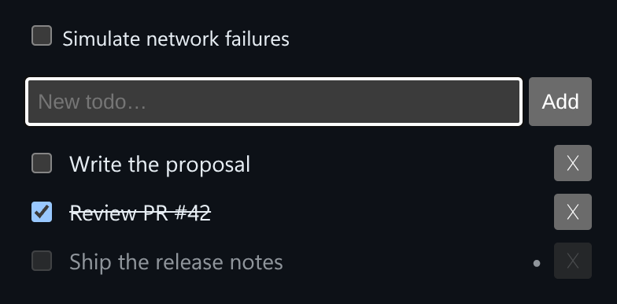

# Optimistic Todos

A todo list that updates immediately and rolls back to the exact previous state if the server call fails.



*"Ship the release notes" appears at once with a pending dot while the fake API call is still running.*

## Features

- **Optimistic add, toggle and delete**: local state changes before the network call finishes.
- A **pending dot** marks items that are waiting for the server.
- **Exact rollback**: if a call fails, a deleted item comes back in its original position and a toggle flips back.
- An **error banner** says which action failed.
- A **Simulate network failures** switch in the demo to show the rollback.

## How it works

Before each change, the component saves the current list. If the API promise rejects, it restores that saved list, so the rollback is exact.

## Usage

```tsx
import { OptimisticTodos, type TodosApi } from './OptimisticTodos';

const api: TodosApi = {
  addTodo: (text) => fetch(/* ... */).then((r) => r.json()),
  toggleTodo: (id) => fetch(/* ... */).then(() => {}),
  deleteTodo: (id) => fetch(/* ... */).then(() => {}),
};

<OptimisticTodos api={api} />
```

## API

- `<OptimisticTodos api: TodosApi />`
- `TodosApi`: `{ addTodo(text): Promise<Todo>, toggleTodo(id): Promise<void>, deleteTodo(id): Promise<void> }`
- Default export `Demo`: a fake in-memory API with a 250ms delay and a failure switch.

## Files

| File | Purpose |
| --- | --- |
| [`OptimisticTodos.tsx`](OptimisticTodos.tsx) | Component, hooks and demo (default export) |
| [`preview.png`](preview.png) | Screenshot of the running demo |

Only depends on `react`.
