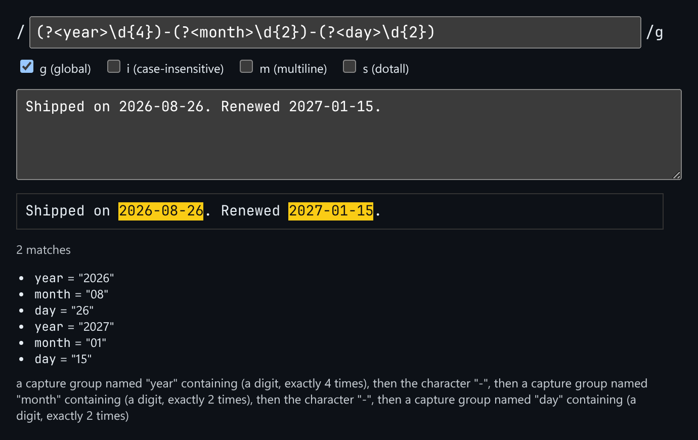

# Regex Playground

Live regex match highlighting, named capture groups, and a plain-English description of the pattern.



*A date pattern with named groups matched against sample text, with the groups listed and the pattern explained in English.*

## Features

- **Live match highlighting** on the test string.
- **Flag toggles**: `g`, `i`, `m`, `s`.
- A **match count** and a list of **named capture groups** for each match.
- A **plain-English breakdown** built by reading the pattern text itself, covering groups, quantifiers, character classes and alternatives.
- Zero-length matches are handled without looping forever.

## How it works

JavaScript regexes can't describe themselves, so the breakdown is produced by a small walker that reads the pattern one alternative at a time and turns each token into words.

## Usage

```tsx
import { RegexPlayground } from './RegexPlayground';

<RegexPlayground
  initialPattern="(?<year>\d{4})-(?<month>\d{2})"
  initialFlags="g"
  initialInput="Shipped on 2026-08-26."
/>
```

## API

- `<RegexPlayground initialPattern? initialFlags? initialInput? />`
- Default export `Demo`: starts with a date pattern.

## Files

| File | Purpose |
| --- | --- |
| [`RegexPlayground.tsx`](RegexPlayground.tsx) | Component, hooks and demo (default export) |
| [`preview.png`](preview.png) | Screenshot of the running demo |

Only depends on `react`.
