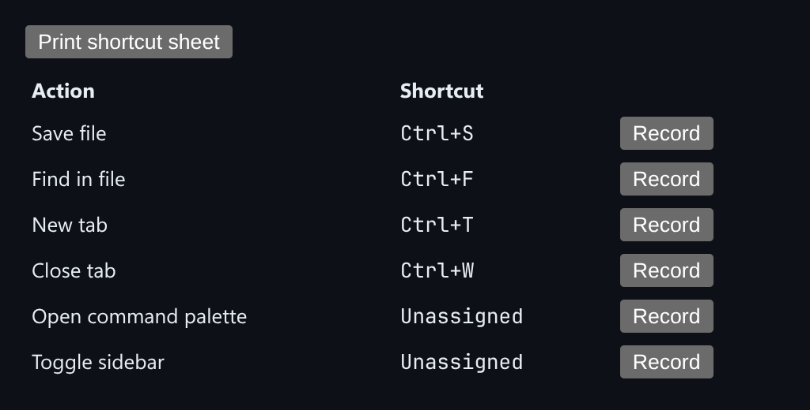

# Keyboard Shortcut Manager

Record shortcuts by pressing them, with conflict detection and a printable shortcut sheet.



*A list of actions with their recorded chords. Unassigned actions are labeled as such.*

## Features

- **Record** a chord by pressing it instead of typing it.
- **Normalized chords**: modifier order is fixed, so `Shift+Ctrl+K` and `Ctrl+Shift+K` are treated as the same chord.
- Recording **waits for a non-modifier key** before finishing.
- **Conflict detection** as soon as two actions share a chord.
- A **printable shortcut sheet**: the controls are hidden under `@media print`, so the printout is just a clean table of actions and chords.

## How it works

Each `KeyboardEvent` is converted into a standard string such as `Ctrl+Shift+K`. Conflicts are found by grouping actions by that string.

## Usage

```tsx
import { ShortcutManager } from './ShortcutManager';

<ShortcutManager actions={[{ id: 'save', description: 'Save file', chord: 'Ctrl+S' }]} />
```

## API

- `<ShortcutManager actions?: { id, description, chord: string | null }[] />`
- Default export `Demo`: starts with a few sample actions.

## Files

| File | Purpose |
| --- | --- |
| [`ShortcutManager.tsx`](ShortcutManager.tsx) | Component, hooks and demo (default export) |
| [`preview.png`](preview.png) | Screenshot of the running demo |

Only depends on `react`.
