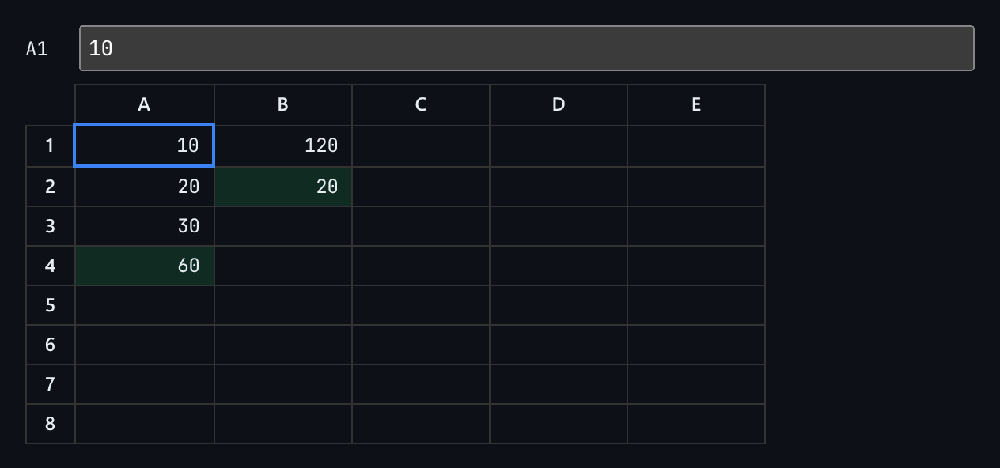

# Spreadsheet Formula Grid

A spreadsheet grid with formulas parsed into syntax trees, evaluated with memoized recursion, and protected against circular references.



*With A1 selected, the cells that depend on it are highlighted in green.*

## Features

- Cells hold **literals or formulas**, for example `=A1+B2*2`, `=SUM(A1:A3)` or `=AVERAGE(B1,B2,B3)`.
- A **tokenizer and parser** turn each formula into a syntax tree and collect the cells it references.
- **Memoized recursive evaluation**, so cells are calculated in dependency order.
- **`#CIRCULAR` detection** for a cell that refers to itself directly or through a chain, instead of hanging.
- **Dependency highlighting** for the selected cell: what it depends on, and what depends on it.
- A **formula bar** for editing the selected cell.

## How it works

Every edit re-parses and re-evaluates the whole grid. The reference lists collected during parsing are used both for evaluation order and for the highlighting.

## Usage

```tsx
import { SpreadsheetGrid, evaluateGrid } from './SpreadsheetGrid';

<SpreadsheetGrid initialCells={{ A1: '10', B1: '=A1*2' }} />

evaluateGrid({ A1: '=B1', B1: '=A1' }).A1.error; // 'CIRCULAR' (shown in the grid as #CIRCULAR)
```

## API

- `<SpreadsheetGrid initialCells?: Record<string, string> />`
- `evaluateGrid(cells): Record<string, CellResult>`, where `CellResult` is `{ value, error?, deps }`.
- Default export `Demo`: starts with a small worked example.

## Files

| File | Purpose |
| --- | --- |
| [`SpreadsheetGrid.tsx`](SpreadsheetGrid.tsx) | Component, hooks and demo (default export) |
| [`preview.png`](preview.png) | Screenshot of the running demo |

Only depends on `react`.
