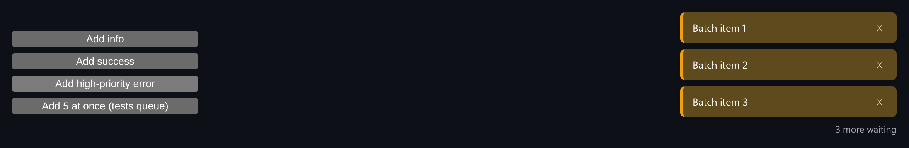

# Toast Notification System

A toast queue with priorities and stacking, where hovering pauses a toast and keeps its remaining time.



*"Add 5 at once" fills the 3 visible slots, and the rest wait in the queue ("+3 more waiting").*

## Features

- **Limited visible slots** (`maxVisible`, default 3). Extra toasts wait in a queue and slide in as slots open.
- **Priority queue**: `high`, then `normal`, then `low`.
- **Pause on hover keeps the remaining time**. Hovering pauses the countdown without resetting it, so a toast that was about to close doesn't get a full new duration.
- **Auto-dismiss timers** plus a manual close button.
- Four types with their own colors: `info`, `success`, `warning`, `error`.

## How it works

Each visible toast has a timer that records `remaining` and `startedAt`. Pausing subtracts the time already elapsed from `remaining`, and resuming starts a new timer for only what is left.

## Usage

```tsx
import { useToastQueue, ToastViewport } from './ToastSystem';

const { toasts, queued, addToast, dismiss, pause, resume } = useToastQueue();

<ToastViewport
  toasts={toasts}
  queued={queued}
  onDismiss={dismiss}
  onPause={pause}
  onResume={resume}
/>

addToast({ message: 'Saved', type: 'success', priority: 'normal' });
```

## API

- `useToastQueue(maxVisible = 3)` returns `{ toasts, queued, addToast, dismiss, pause, resume }`.
- `addToast({ message, type?, priority?, duration? })`
- `<ToastViewport toasts queued onDismiss onPause onResume />`

## Files

| File | Purpose |
| --- | --- |
| [`ToastSystem.tsx`](ToastSystem.tsx) | Component, hooks and demo (default export) |
| [`preview.png`](preview.png) | Screenshot of the running demo |

Only depends on `react`.
