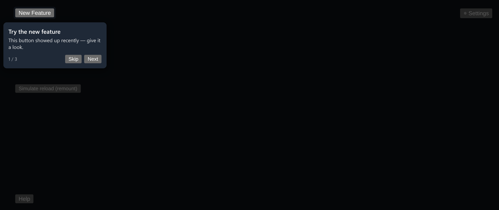

# Onboarding Tour Overlay

A step-by-step onboarding tour with a box-shadow spotlight, popovers that find room in the viewport, and progress that survives a reload.



*Step 1 of 3: the spotlight cuts out "New Feature" and the popover sits below it.*

## Features

- A **box-shadow spotlight**: a transparent div over the target with `box-shadow: 0 0 0 9999px <dim>`, which is cheaper than an SVG mask.
- **Popover placement that checks the viewport**: tries the sides in order and picks one that actually has room.
- **Falls back sensibly** for targets near an edge. The demo puts one target near the bottom on purpose.
- **Progress saved to localStorage** after every step, so dismissing mid-tour and coming back resumes where you left off.
- **Skip** and **Next** controls with a step counter.

## How it works

`choosePlacement` takes the target rectangle, the popover size and the viewport size, and returns the first side where the popover fits. The tour's progress is stored under `tour-progress:<tourId>`.

## Usage

```tsx
import { TourOverlay } from './TourOverlay';

const steps = [
  { id: 'new', target: '#new-feature-btn', title: 'Try the new feature', content: 'This button showed up recently.' },
  { id: 'settings', target: '#settings-icon', title: 'Settings', content: 'Tune things here.' },
];

<TourOverlay tourId="main-tour" steps={steps} />
```

## API

- `<TourOverlay tourId: string steps: TourStep[] />`
- `TourStep`: `{ id, target (CSS selector), title, content }`
- `choosePlacement(targetRect, popoverSize, viewport)`: the pure placement function.
- Default export `Demo`: three targets, one near the bottom edge, plus a "Simulate reload" button.

## Files

| File | Purpose |
| --- | --- |
| [`TourOverlay.tsx`](TourOverlay.tsx) | Component, placement logic and demo (default export) |
| [`preview.png`](preview.png) | Screenshot of the running demo |

Only depends on `react`.
