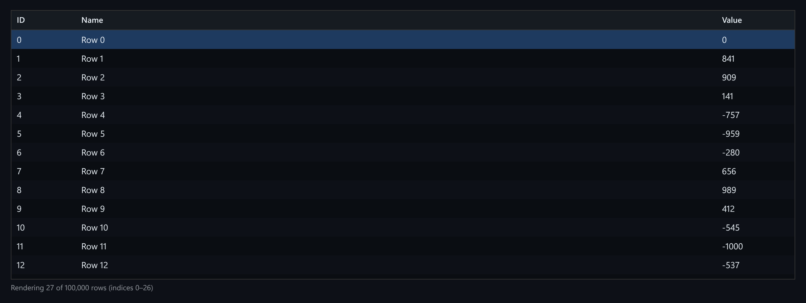

# Virtualized Table

A table that renders 100,000 rows by drawing only the rows near the viewport.



*100,000 rows, with only 27 in the DOM at a time.*

## Features

- **Windowed rendering**: only the visible rows plus a small overscan are mounted.
- A **fixed row height**, so each row's position is a multiplication (`index * rowHeight`) with no measuring pass.
- A **sticky header** while the body scrolls.
- **Full keyboard navigation**: arrows, PageUp/PageDown, Home/End.
- The focused row is **scrolled into view even when it isn't currently rendered**.
- A live readout of which row indices are mounted.

## How it works

The visible range comes from `scrollTop / rowHeight` and the container height. A spacer as tall as all the rows keeps the scrollbar honest while only the window is mounted.

## Usage

```tsx
import { VirtualizedTable } from './VirtualizedTable';

<VirtualizedTable rows={data} rowHeight={28} height={400} />
```

## API

- `<VirtualizedTable rows: Row[] rowHeight?: number height?: number />` (defaults: 28 and 400)
- `Row`: `{ id: number, name: string, value: number }`
- Default export `Demo`: 100,000 synthetic rows.

## Files

| File | Purpose |
| --- | --- |
| [`VirtualizedTable.tsx`](VirtualizedTable.tsx) | Component and demo (default export) |
| [`preview.png`](preview.png) | Screenshot of the running demo |

Only depends on `react`.
