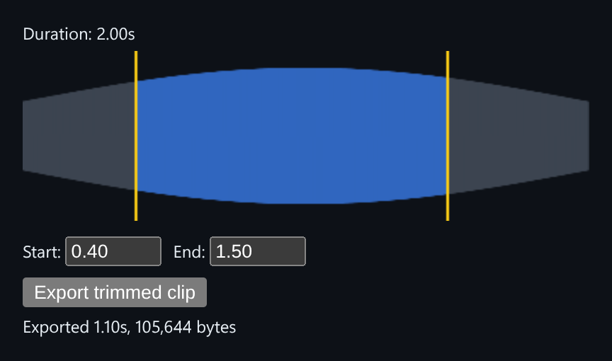

# Audio Waveform Trimmer

Draw a waveform from real decoded audio, choose a range, and export the trimmed clip as a WAV with an exact byte size.



*Trimming 0.40s to 1.50s exports 105,644 bytes: exactly 44 + 52,800 samples × 2 bytes at the AudioContext's 48 kHz.*

## Features

- **Synthesises a tone as raw PCM** (a frequency sweep with an envelope), so there's no file to upload.
- **Encodes it into a real WAV container** and decodes it back with **`AudioContext.decodeAudioData`**.
- **Peaks per pixel column** (the min and max sample in each bucket) drawn to a canvas.
- **Start and end handles** to select a range.
- **Exports the selection as its own WAV blob**, with its duration and byte size shown.

## How it works

WAV is uncompressed, so the exported size is exactly `44 + samples * bytesPerSample`, a relationship you can check instead of an approximation. Decoding real encoded bytes exercises the Web Audio path a real upload would use.

## Usage

```tsx
import WaveformTrimmer from './WaveformTrimmer';

<WaveformTrimmer />
```

## API

- Default export `WaveformTrimmer`: takes no props.

## Files

| File | Purpose |
| --- | --- |
| [`WaveformTrimmer.tsx`](WaveformTrimmer.tsx) | WAV encoder, peak computation, component |
| [`preview.png`](preview.png) | Screenshot of the running demo |

Only depends on `react`.
